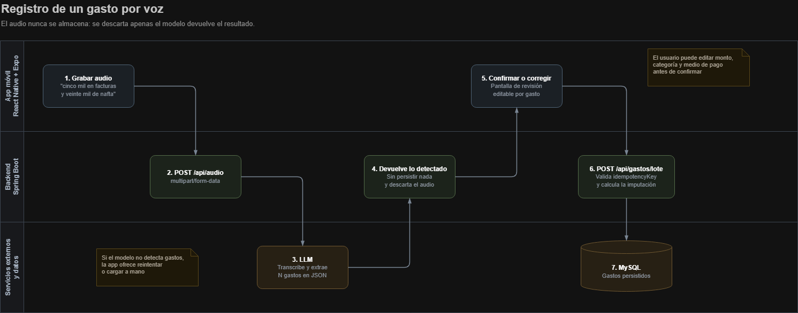
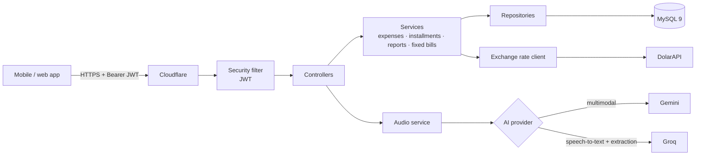

# Pocket API

Backend of **Pocket**, a personal finance mobile app whose core feature is **logging expenses by voice**. The user records a short audio in natural language — *"I spent five thousand on pastries and twenty thousand on gas"* — and an AI model transcribes it and extracts **several structured expenses from a single recording**. The user reviews and confirms them before anything is saved.

On top of that, Pocket groups spending by category, flags **"ant expenses"** (small, repeated, avoidable purchases), compares the month against the **historical average**, tracks **fixed monthly bills**, splits **debit** from **credit card spending with installments**, and can show every amount converted to the Argentine **"blue" dollar** rate.

**Live demo:** [pocket.lautaromoreyra.dev](https://pocket.lautaromoreyra.dev) · Mobile app: [pocket-frontend](https://github.com/lautaromoreyraa/pocket-frontend)


## How voice logging works



1. The app uploads the recording to `POST /api/audio`.
2. The configured AI provider turns speech into a list of expense drafts (amount, category, payment method, installments).
3. A **coherence check** discards the answer if any amount does not appear in the transcription — models that can't really hear the audio tend to invent plausible-looking expenses instead of failing.
4. The drafts go back to the app; nothing is persisted until the user confirms them (`POST /api/gastos/lote`).

The audio is discarded as soon as it is processed: it is never stored.

## Tech stack

| Layer | Choice |
|---|---|
| Language / framework | Java 21, Spring Boot 3.5 (Web, Data JPA, Security, Validation, Actuator) |
| Database | MySQL 9, schema owned by Flyway |
| AI | Google Gemini (multimodal) or Groq (Whisper + a text model), selectable by configuration |
| Auth | Device-based identity with stateless JWT |
| External data | Exchange rates from DolarAPI |
| Tests | JUnit 5, Spring Boot Test, H2 in MySQL mode |
| Runtime | Multi-stage Docker image, non-root user, layered jar |
| Hosting | Railway behind Cloudflare |

## Architecture



Layered Spring application: controllers only deal with HTTP, services hold the rules, repositories persist, and mappers translate between entities and DTOs.

## Design decisions worth a look

- **An installment is an expense.** There is no installments table: a purchase in 6 installments inserts 6 rows in `gasto`, linked to the parent purchase and dated in the months they fall due. Monthly totals, averages and savings capacity come from a single query, with no `UNION`s or special cases.
- **Two dates per expense.** When it happened and which month it is charged to. They match for debit and differ for credit, and every report queries by the second one, so installments land in the right month by themselves.
- **The last installment absorbs the rounding.** $12,500 in 9 installments doesn't divide evenly at any precision: each installment is rounded down and the last one is `total − installment × (n − 1)`, so the sum is exact to the cent — the same thing banks do.
- **Idempotent writes.** The app works offline and queues recordings; if a response is lost and the client retries, an `idempotencyKey` prevents duplicates.
- **Business rules live in configuration.** Thresholds such as how many occurrences make an "ant expense" or how many months the historical average needs are in `application.yml`, not hard-coded.
- **The AI model is pinned.** Aliases like `*-latest` can resolve to models that don't actually process audio and fabricate results; model changes are validated against real recordings first.

## Project structure

```
src/main/java/com/pocket
├── config/       configuration properties and Spring setup
├── controller/   REST endpoints
├── domain/       JPA entities (Gasto, CompraFinanciada, GastoFijo, Ingreso, Usuario, …)
├── dto/          request and response records, grouped by use case
├── enumeration/  payment methods, expense origin, …
├── event/        domain events (e.g. seeding demo data for a new user)
├── exception/    custom exceptions and the global error handler
├── mapper/       entity ⇄ DTO, interface + hand-written impl/
├── repository/   Spring Data interfaces
├── security/     JWT filter and security configuration
├── service/<area>/ business logic: audio, ia, gasto, cuota, compra, gastofijo, hormiga, resumen, cotizacion, …
└── util/         stateless helpers
src/main/resources/db/migration   Flyway migrations
```

Domain names are in Spanish (`Gasto`, `Cuota`, `Hormiga`) because that's the language of the product; technical suffixes stay in English.

## API overview

| Area | Endpoints |
|---|---|
| Auth | `POST /api/auth/dispositivo` |
| Voice | `POST /api/audio` |
| Expenses | `GET POST /api/gastos`, `POST /api/gastos/lote`, `PUT DELETE /api/gastos/{id}` |
| Credit purchases | `GET /api/compras/en-curso`, `POST /api/compras`, `PUT DELETE /api/compras/{id}` |
| Fixed bills | `GET POST /api/gastos-fijos`, `GET /api/gastos-fijos/resumen`, `POST /api/gastos-fijos/{id}/registrar`, … |
| Income | `GET POST /api/ingresos`, `DELETE /api/ingresos/{id}` |
| Reports | `GET /api/resumen`, `GET /api/resumen/periodos`, `GET /api/categorias` |
| Exchange rate | `GET /api/cotizacion/blue` |

## Getting started

**Prerequisites:** Java 21 and Docker (or Podman with the Docker CLI).

```bash
# 1. Local database
docker compose up -d

# 2. Local secrets (file ignored by git)
cp application-local.properties.example application-local.properties
#    → set pocket.security.jwt.secret and pocket.ia.api-key

# 3. Run
./mvnw spring-boot:run      # http://localhost:8080, "dev" profile by default
```

To run the API in a container as well: `docker compose --profile full up -d --build`.

### Tests

```bash
./mvnw test
```

## Deployment

Production runs the `prod` profile on Railway, configured entirely through environment variables. The `Dockerfile` builds in two stages, splits the jar into Spring Boot layers and runs as an unprivileged user with an explicit JVM memory ceiling; Railway only promotes a deployment once `/actuator/health` reports `UP`. Service settings live in `.railway/railway.ts`.
